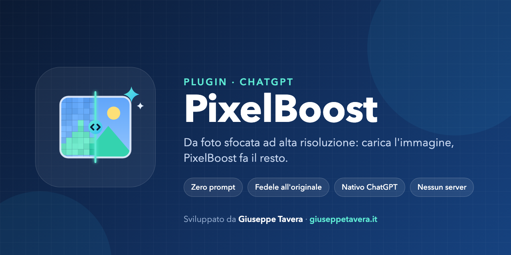

<p align="center">
  
</p>

<p align="center">
  <strong>Il plugin per ChatGPT che trasforma le foto sfocate in immagini ad alta risoluzione.</strong><br>
  Carichi la foto, PixelBoost fa il resto: niente prompt da scrivere, niente server, niente servizi esterni.
</p>

---

## Perché

Rendere nitida una foto con un modello generativo è facile. Farlo **senza stravolgerla** no: il rischio è ritrovarsi con un volto diverso, una barba più folta, uno sfondo reinventato. **PixelBoost** è costruito per l'opposto:

- **Zero prompt.** Con il plugin attivo basta allegare un'immagine: parte da solo, senza chiedere conferme o preferenze.
- **Fedele all'originale.** Migliora solo i dettagli già visibili. Identità, espressione, composizione, colori, luce e sfondo restano quelli della foto caricata.
- **Nativo ChatGPT.** Usa la capacità di modifica immagini già integrata in ChatGPT. Nessuna API key, nessun MCP, nessun server.
- **Onesto sui limiti.** Non dichiara dimensioni che non ha verificato e non spaccia una ricostruzione generativa per un recupero certo di dettagli reali.

## Cosa fa

PixelBoost è un plugin con una sola skill, `pixel-boost`. Quando carichi un'immagine:

1. la prende come riferimento diretto della modifica (non la ridescrive per generarne una nuova);
2. invia allo strumento immagini di ChatGPT il prompt **Ultra-Premium 16K Professional Remaster & Enhancement**, completo di negative prompt, senza riassumerlo né riscriverlo;
3. chiede **una sola versione migliorata** alla massima qualità e risoluzione supportate, mantenendo orientamento, proporzioni e trasparenza;
4. restituisce direttamente l'immagine, senza varianti, collage, confronti prima/dopo o filigrane.

Il prompt lavora su super-risoluzione, nitidezza naturale, riduzione di rumore e artefatti di compressione, rifinitura delle texture e micro-contrasto. Il negative prompt esclude esplicitamente cambi di identità o età, peli e pori inventati, pelle "di plastica", oversharpening, oggetti aggiunti e sfondi ridisegnati.

Funziona soprattutto con:

| Tipo di immagine | Cosa aspettarsi |
|---|---|
| **Foto sfocate o mosse** | Contorni più definiti e dettagli più leggibili, senza alterare soggetto e scena |
| **Foto a bassa risoluzione o sgranate** | Upscaling con meno rumore e meno artefatti JPEG |
| **Vecchie foto digitalizzate** | Più pulizia e nitidezza, mantenendo colori e luce originali |
| **Illustrazioni, screenshot, loghi** | Più definizione nello **stile originale**: non vengono convertiti in fotografie, e testi e loghi esistenti restano com'erano |

Se alleghi più immagini, PixelBoost le elabora una per una, ciascuna col proprio riferimento, senza fonderle.

## Installazione

Il repository contiene due manifest con gli stessi metadati:

- `plugin.json`: manifest nel formato [Agent Plugins](https://agent-plugins.org), con l'estensione `com.openai` per ChatGPT;
- `.codex-plugin/plugin.json`: manifest per Codex / ChatGPT, che punta alla cartella `skills/`.

Clona il repository:

```bash
git clone https://gitlab.com/giusetavera/pixel-boost.git
```

oppure crea uno ZIP pulito del plugin (il banner del README resta fuori dall'archivio):

```bash
git archive --format=zip --prefix=pixel-boost/ -o pixel-boost.zip HEAD
```

Poi installa la cartella o lo ZIP seguendo la procedura per i plugin del tuo client ChatGPT / Codex. I nomi dei menu possono cambiare in base a piano e versione.

### Altri agenti

La skill segue il formato aperto **Agent Skills** (`SKILL.md` con front matter YAML), quindi qualsiasi agente compatibile può caricarla da `skills/pixel-boost/`. L'agente deve però avere uno strumento nativo di modifica immagini: PixelBoost non ne porta uno suo.

## Uso

Attiva il plugin e **allega la foto**. Non serve scrivere nulla.

Se vuoi essere esplicito:

> Rendi nitida e ad alta risoluzione questa foto.

> Usa $pixel-boost su tutte e tre le immagini allegate.

Se nello stesso messaggio chiedi qualcos'altro (per esempio "descrivi questa foto" o "rimuovi lo sfondo"), PixelBoost rispetta la tua richiesta invece di avviare il miglioramento.

Consigli:

- **Carica l'originale.** Più pixel e meno compressione ci sono in partenza, più il risultato resta fedele. Evita gli screenshot di una foto se hai il file.
- **Una foto, un risultato.** PixelBoost non rigenera da solo altre versioni "più spettacolari". Se il risultato non ti convince, chiedi esplicitamente un nuovo tentativo.

## Struttura del repository

```
pixel-boost/
├── plugin.json                     # manifest Agent Plugins + estensione com.openai
├── .codex-plugin/
│   └── plugin.json                 # manifest Codex / ChatGPT
├── skills/
│   └── pixel-boost/
│       ├── SKILL.md                # istruzioni operative + prompt da trasmettere integralmente
│       └── agents/
│           └── openai.yaml         # nome, descrizione e prompt di default per l'interfaccia
└── assets/
    └── img/
        ├── icon.png                # logo e icona del composer (512×512)
        └── banner.png              # artwork del README (escluso dallo ZIP)
```

**`SKILL.md`** contiene tutto il comportamento del plugin: quando attivarsi, come scegliere l'immagine, cosa non fare e il prompt inglese da passare **parola per parola** allo strumento immagini. Se vuoi cambiare lo stile del risultato, è il prompt in fondo a questo file che devi modificare.

Se modifichi nome, descrizioni o versione, aggiorna **entrambi** i manifest: devono restare allineati.

## Limiti, onestamente

- La qualità finale dipende dallo strumento immagini di ChatGPT disponibile nel tuo account. "16K" nel prompt è un obiettivo di qualità, non una garanzia di dimensioni native: PixelBoost dichiara una risoluzione solo se la verifica nell'output.
- I dettagli che nella foto non ci sono non si possono recuperare davvero. Su immagini molto degradate il modello **ricostruisce**, e una ricostruzione può essere plausibile ma sbagliata.
- Per usi in cui conta l'autenticità (documenti, prove, archivi storici, perizie), tratta il risultato come una versione migliorata a scopo di visione, non come l'originale.
- Se la modifica immagini nativa non è disponibile o restituisce un errore, PixelBoost lo dice. Non finge un risultato e non passa a servizi esterni.

## Versioni

**1.0.0**: prima versione di PixelBoost, erede del plugin legacy *HD Photo Remaster* (`hd-photo-remaster`). Nuovo nome, nuova identità visiva e skill riorientata sulla trasformazione di foto sfocate in immagini ad alta risoluzione.

## Autore

Sviluppato da **Giuseppe Tavera** · [giuseppetavera.it](https://giuseppetavera.it). Feedback, segnalazioni e merge request sono benvenuti.
