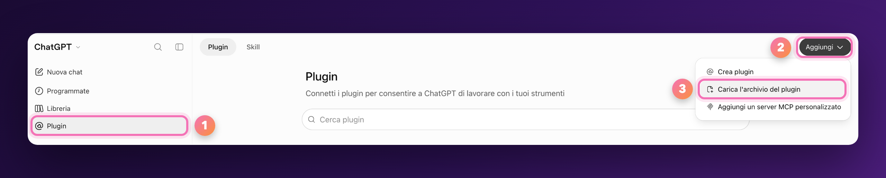
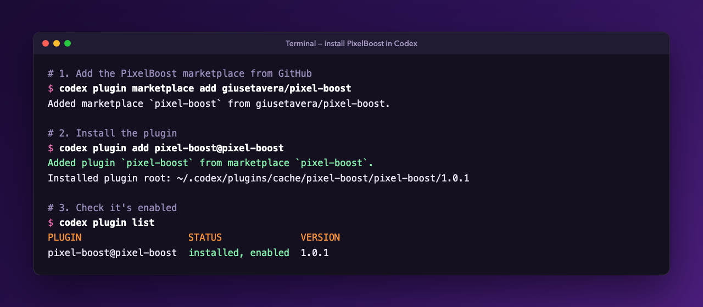

<p align="center">
  
</p>

<p align="center">
  <strong>The ChatGPT plugin that turns blurry photos into high-resolution images.</strong><br>
  Upload the photo and PixelBoost does the rest: no prompts to write, no servers, no external services.
</p>

---

## Why

Sharpening a photo with a generative model is easy. Doing it **without changing the photo** is not: you can end up with a different face, a thicker beard or a reinvented background. **PixelBoost** is built to avoid that:

- **Zero prompts.** With the plugin active, just attach an image. It starts on its own, without asking for confirmation or preferences.
- **Faithful to the original.** It enhances only details that are already visible. Identity, expression, composition, colours, lighting and background stay as they are in the uploaded photo.
- **Native to ChatGPT.** It uses the image editing capability built into ChatGPT. No API keys, no MCP, no servers.
- **Honest about its limits.** It never claims dimensions it hasn't verified, and it never passes off a generative reconstruction as a reliable recovery of real detail.

## What it does

PixelBoost is a plugin with a single skill, `pixel-boost`. When you upload an image, it:

1. uses the image itself as the reference for the edit (it doesn't describe it and generate a new one);
2. sends ChatGPT's image tool the **Ultra-Premium 16K Professional Remaster & Enhancement** prompt, negative prompt included, without summarising or rewriting it;
3. requests **a single enhanced version** at the highest quality and resolution supported, keeping the original orientation, aspect ratio and transparency;
4. returns the image directly, with no variants, collages, before/after comparisons or watermarks.

The prompt covers super-resolution, natural sharpening, noise and compression-artifact removal, texture refinement and micro-contrast. The negative prompt explicitly rules out identity or age changes, invented hair and pores, plastic-looking skin, oversharpening, added objects and redesigned backgrounds.

It works best on:

| Image type | What to expect |
|---|---|
| **Blurry or shaky photos** | Sharper edges and more legible detail, without altering the subject or the scene |
| **Low-resolution or grainy photos** | Upscaling with less noise and fewer JPEG artifacts |
| **Scanned old photos** | Cleaner, sharper results that keep the original colours and lighting |
| **Illustrations, screenshots, logos** | More definition in the **original style**: they are not turned into photographs, and existing text and logos stay as they were |

If you attach several images, PixelBoost processes them one at a time, each with its own reference, and never merges them.

## Installation

PixelBoost isn't in the public ChatGPT plugin directory yet. Until it is, you can install it on your own account in a minute.

### ChatGPT

1. Download `pixel-boost-<version>.zip` from the [latest release](https://github.com/giusetavera/pixel-boost/releases/latest). Don't unzip it.
2. Sign in to [ChatGPT](https://chatgpt.com) and open **Plugins** from the left sidebar.
3. Click **Add** in the top right.
4. Choose the option to upload a plugin archive and select the ZIP you downloaded.

<p align="center">
  <br>
  <sub>The screenshot shows the Italian interface: <em>Plugin</em> → <em>Aggiungi</em> → <em>Carica l'archivio del plugin</em>. Labels follow your ChatGPT language.</sub>
</p>

That's it: PixelBoost is now installed on your account. Start a new chat and attach a photo, or type `@` and pick PixelBoost to call it explicitly (see [Usage](#usage)).

To update it, download the ZIP of the new release and upload it the same way.

### Codex CLI

This repository is also a plugin marketplace, so Codex can install PixelBoost straight from GitHub:

```bash
codex plugin marketplace add giusetavera/pixel-boost
codex plugin add pixel-boost@pixel-boost
```

<p align="center">
  
</p>

Run `codex plugin list` to check that it shows `installed, enabled`. To uninstall it:

```bash
codex plugin remove pixel-boost@pixel-boost
codex plugin marketplace remove pixel-boost
```

### Other AI agents

The skill follows the open **Agent Skills** format (`SKILL.md` with YAML front matter), so any compatible agent can load it from `skills/pixel-boost/`. The agent must have a native image editing tool, though: PixelBoost doesn't bring its own.

## Usage

Activate the plugin and **attach the photo**. You don't need to write anything.

If you want to be explicit:

> Make this photo sharp and high resolution.

> Use $pixel-boost on all three attached images.

If the same message asks for something else (for example "describe this photo" or "remove the background"), PixelBoost follows your request instead of running the enhancement.

PixelBoost replies in the language you write in.

Tips:

- **Upload the original.** The more pixels and the less compression you start with, the more faithful the result. Avoid screenshots of a photo if you have the file.
- **One photo, one result.** PixelBoost doesn't generate extra "more spectacular" versions on its own. If you don't like the result, ask for another attempt explicitly.

## Repository structure

```
pixel-boost/
├── plugin.json                     # Agent Plugins manifest + com.openai extension
├── PRIVACY.md                      # privacy policy (linked from the listing)
├── TERMS.md                        # terms of use (linked from the listing)
├── .codex-plugin/
│   └── plugin.json                 # Codex / ChatGPT manifest
├── .agents/plugins/
│   └── marketplace.json            # lets Codex install the plugin from this repo
├── skills/
│   └── pixel-boost/
│       ├── SKILL.md                # operating instructions + prompt passed verbatim
│       └── agents/
│           └── openai.yaml         # display name, description and default prompt
└── assets/
    └── img/
        ├── icon.png                # logo and composer icon (512×512)
        ├── banner.png              # README artwork (excluded from the ZIP)
        ├── install-chatgpt.png     # README artwork (excluded from the ZIP)
        └── install-codex.png       # README artwork (excluded from the ZIP)
```

**`SKILL.md`** holds all of the plugin's behaviour: when to trigger, how to pick the image, what not to do, and the English prompt passed **word for word** to the image tool. To change the style of the result, edit the prompt at the bottom of that file.

If you change the name, descriptions or version, update **both** manifests: they must stay in sync.

### Releasing

Development happens on GitLab, which mirrors `main` to GitHub. On every push to `main`, the [release workflow](.github/workflows/release.yml) on GitHub reads `version` from the manifests: if no release exists for it yet, it creates the `v<version>` tag, a GitHub release with generated notes and the plugin ZIP attached. Otherwise it does nothing. To publish a new version, bump `version` in both manifests and push to `main`.

## Limits, honestly

- The final quality depends on the ChatGPT image tool available on your account. "16K" in the prompt is a quality target, not a guarantee of native dimensions: PixelBoost states a resolution only after verifying it in the output.
- Detail that isn't in the photo can't truly be recovered. On heavily degraded images the model **reconstructs**, and a reconstruction can be plausible yet wrong.
- Where authenticity matters (documents, evidence, historical archives, forensic work), treat the result as an enhanced viewing copy, not as the original.
- If native image editing is unavailable or returns an error, PixelBoost says so. It doesn't fake a result or fall back to external services.

## Changelog

**1.0.1**: listing metadata for the ChatGPT plugin directory: shorter subtitle, capabilities, support, privacy policy and terms of service links.

**1.0.0**: first release of PixelBoost, successor to the legacy *HD Photo Remaster* plugin (`hd-photo-remaster`). New name, new visual identity, and a skill refocused on turning blurry photos into high-resolution images.

## Author

Developed by **Giuseppe Tavera** · [giuseppetavera.it](https://giuseppetavera.it). Feedback, issues and pull requests are welcome on [GitHub](https://github.com/giusetavera/pixel-boost/issues).

See also the [privacy policy](PRIVACY.md) and the [terms of use](TERMS.md).
